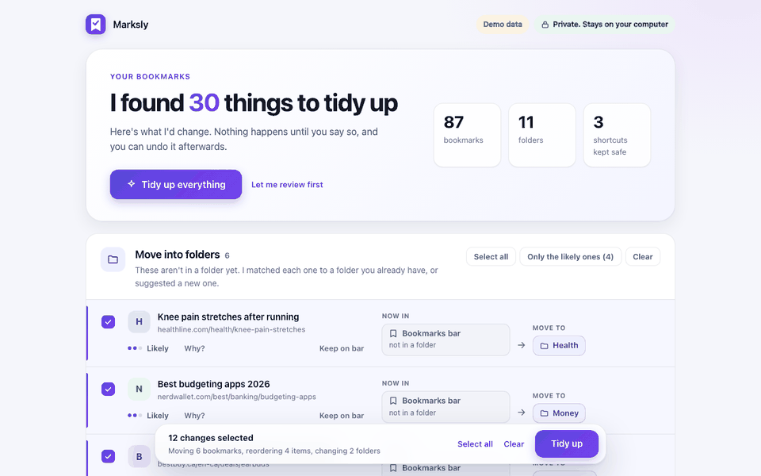
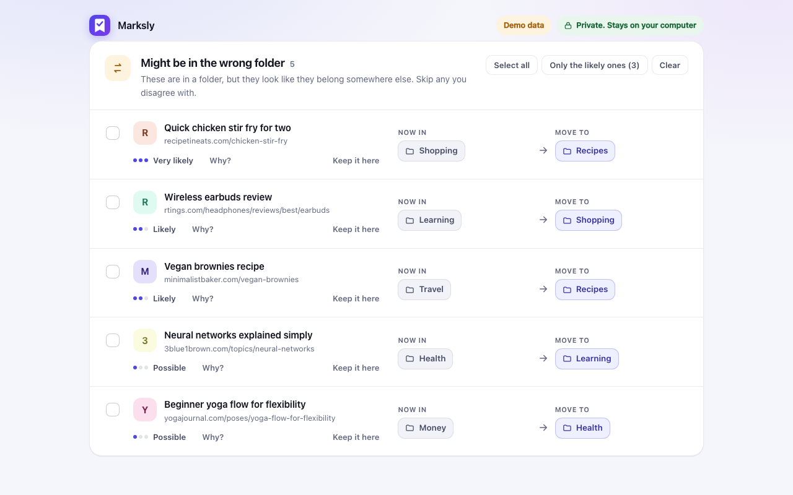

<p align="center">
  
</p>

<h1 align="center">Marksly</h1>

<p align="center"><b>Bookmarks that tidy themselves.</b><br>
See every move first. Undo in one click. Runs on your device: no account, no API key, no upload.</p>

<p align="center">
  
  
  
</p>

<p align="center"><a href="README.zh-CN.md">中文说明</a></p>

<p align="center">
  
</p>

You have hundreds of bookmarks, no time to sort them, and half of them are in the wrong folder. Marksly reads what is already in your folders, proposes a clean-up, and **shows every move as `where it is now → where it should go` before anything changes**. You tick what you like (or press **Tidy up everything**) and can undo the whole run afterwards.

## What it does

| | |
|---|---|
| 🔍 **Finds misfiled bookmarks** | A stir-fry recipe sitting in *Shopping*, a mortgage article in *Health*. It reads what each bookmark is about, not just its address, and learns what each of *your* folders is for. |
| ⬆️ **Puts what you use most at the top** | In each folder, the bookmarks you open most move up. Everything else keeps its order, newest at the bottom. Busy folders move up too. |
| 🗄️ **Tucks away what you don't use** | Saved over a year ago and not opened since? Offered for an `Archive` folder (never deleted, never ticked for you). |
| 🧹 **Tidies the folders themselves** | Deletes empty folders, merges duplicates (*Recipe* and *Recipes*), and renames *New folder* to what is actually inside. |
| 📌 **Leaves your shortcuts alone** | Gmail, ChatGPT and other things on the bar that you click to *use* never move. |
| ↩️ **Undo** | Every position goes back, including folders that were merged or deleted. |

<p align="center">
  
</p>

## Private by design

- **No account, no API key, no server.** Nothing about your bookmarks leaves the computer.
- **The "understands what a page is about" part is a small model (about 8 MB) bundled inside the extension** ([`potion-base-8M`](https://huggingface.co/minishlab/potion-base-8M), MIT). It runs offline in your browser.
- **There is a test that fails if any network code is added** to the extension (other than reading its own bundled files).
- Permissions: only `bookmarks` and `storage`. Browsing history is an *optional* permission, asked for with a button, only to count how often you visit a bookmark, and can be switched off again. See [PRIVACY.md](PRIVACY.md).

## Install

Not on the Chrome Web Store yet, so install from source (about a minute):

1. [Download this repository as a ZIP](../../archive/refs/heads/main.zip) and unzip it.
2. Open `chrome://extensions` and turn on **Developer mode** (top right).
3. Click **Load unpacked** and choose the `extension` folder.
4. Click the Marksly button in the toolbar.

Nothing is changed until you confirm, and the last run can be undone from the same page.

## How it compares

There are other bookmark tools. Some sort bookmarks by sending them to an online AI service and need an API key; some focus on search or a new-tab page. Marksly's niche is narrower: **fully local, every move previewed, one-click undo, and it focuses on bookmarks that are already in the wrong place**, not only on filing new ones. If you want AI-written folder names from a large language model, or dead-link checking, other tools do that and Marksly does not.

## Honest limits

- The built-in model knows everyday topics (food, travel, money, health, common programming terms). It has **not** heard of newer or very specific products, so it cannot know that "Copilot Studio" belongs with "Power Platform". Folders with fewer than 4 bookmarks cannot be judged.
- "Put what you use most at the top" and "Archive" depend on the *last opened* date Chrome 114+ keeps for each bookmark. Where Chrome has no date, Marksly does not guess: the Archive suggestion switches itself off when too few bookmarks have one.
- Chrome has no hidden bookmarks. `Archive` lives under *Other bookmarks* (off your bar), but it is still visible in the bookmark manager and syncs.
- Measured on invented test libraries, not on yours: it found 11 of 14 planted misfiles on a library it was tuned on, and 7 of 8 on one it was not, with no wrong flags on the second. Details in [docs/how-it-works.md](docs/how-it-works.md).

## How it works

Short version: each bookmark is turned into a small vector (the average meaning of its words), each folder is described by what is inside it, and a bookmark is flagged only when another folder fits clearly better than its own. Every rule, threshold and limit is documented in [docs/how-it-works.md](docs/how-it-works.md).

## Development

No build step and no dependencies.

```bash
node --test extension/tests/*.test.js    # Node 22+
python3 -m unittest discover -s tests    # the small command-line version
bash tools/assets/build_shots.sh         # re-render docs/ screenshots (needs Chrome + Pillow)
```

To try the interface without touching your bookmarks, serve the repository and open the extension page outside Chrome; it loads fictional demo data:

```bash
python3 -m http.server 8765
# open http://127.0.0.1:8765/extension/organizer.html
```

- `extension/src/planner.js`: builds the plan. `learn.js`, `semantic.js`, `embed.js`: what a folder is about. `folders.js`: folder clean-up. `order.js`, `usage.js`: most-used and Archive. `apply.js`: apply and undo.
- `extension/organizer.js`: the interface. All bookmark text is rendered as text, never as HTML.
- `tools/build_model.py`: rebuilds the bundled model files from the original.

## Command-line version

An earlier Python version works on Chrome's `Bookmarks` file and writes an importable HTML file instead of editing Chrome directly. It is the basic version and does not include shortcut protection or misfile detection. See `bookmark_organizer/`.

## Roadmap

- Chrome Web Store listing
- Edit a proposed destination before applying
- Dead-link detection (opt-in)

Ideas and bug reports are welcome in [Issues](../../issues).

## License

MIT. The bundled model is [`minishlab/potion-base-8M`](https://huggingface.co/minishlab/potion-base-8M), also MIT.
